<code>/projects</code> &nbsp;what I've built

 

<a href="https://github.com/Avinashistoocool/Agnostos-v2"></a>
<a href="https://github.com/Avinashistoocool/ISRO-BAH-26"></a>
<a href="https://github.com/Avinashistoocool/GDS-parT-MoE"></a>
<a href="https://github.com/Avinashistoocool/Gated-Dual-Stream-Particle-Transformer"></a>
<a href="https://github.com/Avinashistoocool/asclepius"></a>
<a href="https://github.com/Avinashistoocool/Avinashistoocool.github.io"></a>
<a href="https://github.com/Avinashistoocool/eraksha-hackathon"></a>
<a href="https://github.com/Avinashistoocool/Jet-Class-Particle-Visualizer"></a>
<a href="https://github.com/Avinashistoocool/Object-tracking-with-color"></a>

<code>/stack</code> &nbsp;what I build with

 

<code>/now</code> &nbsp;what I'm up to

 

<code>/contributions</code> &nbsp;the green squares, but orange

 

<code>/contact</code> &nbsp;get in touch

 

[mail](mailto:ph1251520@iitd.ac.in) · [linkedin](https://www.linkedin.com/in/avinashistoocool) · [github](https://github.com/Avinashistoocool)

<code>/support</code> &nbsp;buy me a coffee

 
<a href="https://buymeacoffee.com/avinashistoocool"></a>

[Buy me a coffee](https://buymeacoffee.com/avinashistoocool)

Generated from my repositories by <code>scripts/build.py</code>, refreshed by GitHub Actions.
