# Avinash Chandra Gupta

Hi, I'm **Avinash Chandra Gupta** (Avinash Gupta), a physics student at IIT Delhi. I build machine learning for particle physics,
drone swarms and lunar science, plus open-source research tools.
[Website](https://avinashistoocool.github.io/) · [LinkedIn](https://www.linkedin.com/in/avinashistoocool) · [X](https://x.com/suprcoolavinash)

<code>/projects</code> &nbsp;what I've built

 

<code>/stack</code> &nbsp;what I build with

 

<code>/now</code> &nbsp;what I'm up to

 

<code>/contributions</code> &nbsp;the green squares, but orange

 

<code>/contact</code> &nbsp;get in touch

 

[mail](mailto:ph1251520@iitd.ac.in) · [linkedin](https://www.linkedin.com/in/avinashistoocool) · [github](https://github.com/Avinashistoocool)

<code>/support</code> &nbsp;buy me a coffee

 

[Buy me a coffee](https://buymeacoffee.com/avinashistoocool)

Avinash Chandra Gupta · <a href="https://avinashistoocool.github.io/">avinashistoocool.github.io</a> · generated from my repositories by <code>scripts/build.py</code>, refreshed by GitHub Actions.
